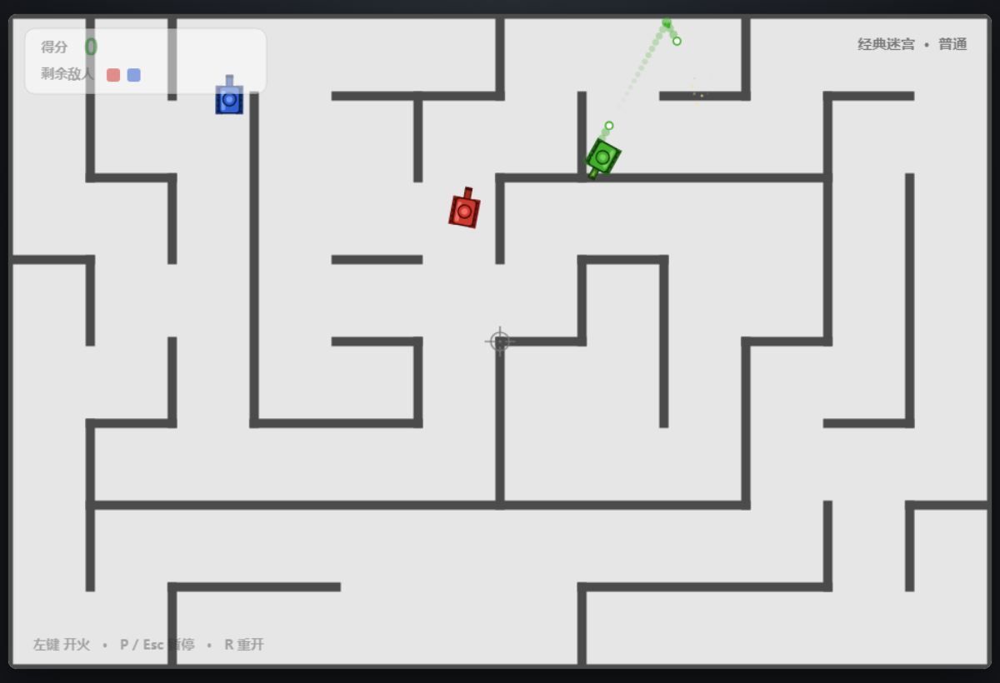
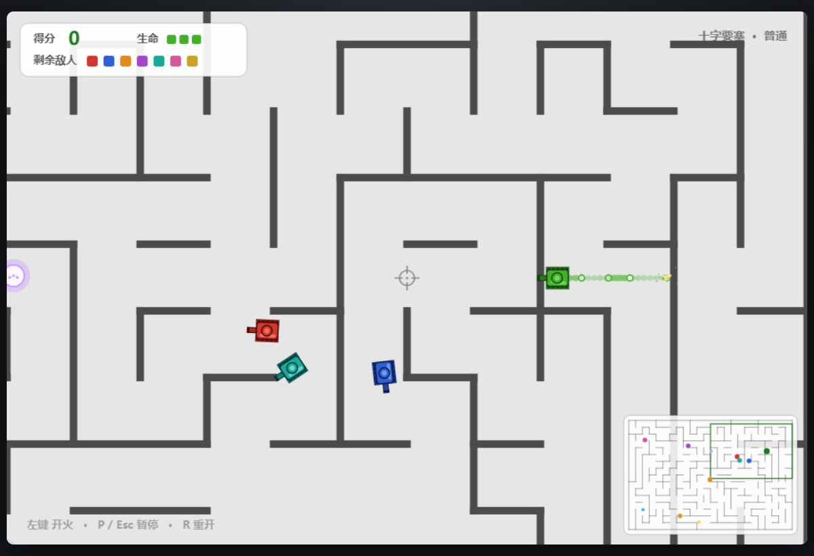
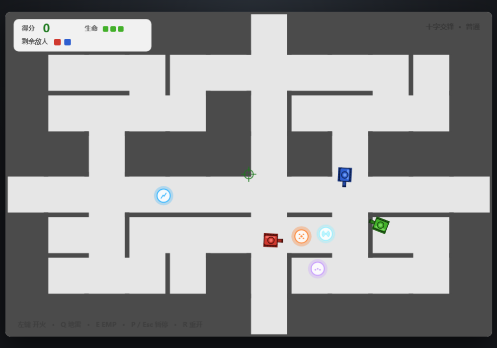
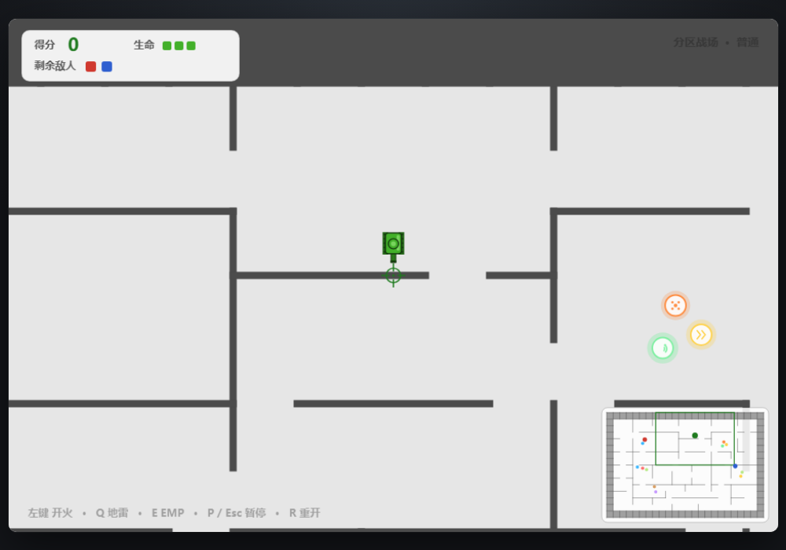

# 坦克动荡：本地版

一款用 **HTML5 Canvas + 原生 JavaScript** 实现的单机迷宫坦克射击游戏。
参考《坦克动荡》的俯视迷宫玩法与用户提供的截图风格，完全离线运行，双击即可游玩。

- **全屏自适应 + 动态扩图**：战斗界面铺满整个浏览器窗口；地图规模随视口动态计算
  （屏幕越大战场越大：小地图铺满视口、大地图等比扩展行列并设上限），
  战斗中缩放窗口只调整视口与渲染，不重建地图
- **冰封峡谷等距伪 3D**：全部地图使用统一的等距视图层（2:1 仿射投影 + 墙体盒体顶面/侧面 +
  画家算法深度排序 + 遮挡感知半透明 + 冰面纹理与落影）；
  世界坐标、碰撞、AI 与战斗数值完全不变，等距只是视图层（`js/isoview.js` + `CONFIG.ISO`）
- 支持 **12 张地图**：6 张小地图 + **6 张大地图（摄像机跟随 + 小地图）** + 随机地图；
  9 种真正不同的布局生成器（迷宫 / 竞技场 / 环形回廊 / 双区域 / 十字 / 街区 / 枢纽 / 多房间 / 环路迷宫）
- **敌人上限**：标准图最多 5 辆、大地图最多 **7 辆**（7 种配色）
- **AI 进攻节奏**：同一时间只有少数敌人主动追击，其余巡逻、捡道具或循枪声支援
- **道具系统**：10 种道具 —— 激光炮 / 散裂弹 / 三连发 / 能量护盾 / 超载引擎
  + **连射过载 / 强化反弹 / EMP 脉冲 / 地雷套件 / 雷达扫描**；
  按地图面积自适应刷新、区域化簇群分布、权重与稀有度、防重复机制
- **生命机制**：默认 3 条命，被击毁后原地复活并附带短暂无敌
- 纯前端、无后端、无 CDN、无网络请求、无外部字体与图片资源
- 主要针对 Windows 上的 **Chrome / Edge**










---

## 1. 快速开始

**方式一（推荐）**：双击项目根目录的 `start.bat`。

**方式二**：直接双击 `index.html`，用 Chrome 或 Edge 打开。

> 本项目使用传统 `<script>` 加载（没有 ES Module / fetch / 跨域资源），
> 因此 `file://` 协议下可以直接运行，**不需要**本地服务器。

如果在极少数被策略限制的环境里浏览器禁止 `file://` 读写，可以在项目根目录执行：

```bat
python -m http.server 8080
```

然后访问 `http://localhost:8080/`（项目本身不依赖此方式）。

---

## 2. 项目结构

```text
坦克动荡-本地版/
├── index.html          # 页面结构：画布 + 菜单/暂停/结算覆盖层
├── style.css           # 界面样式（覆盖层随画面等比缩放）
├── start.bat           # 一键启动脚本
├── README.md
├── js/
│   ├── config.js       # 全局配置：尺寸、速度、半径、冷却、配色、地图预设
│   ├── utils.js        # 数学工具：角度、随机数、最小堆、圆角矩形
│   ├── physics.js      # 通用碰撞：圆-矩形、射线-矩形、线段-圆
│   ├── maze.js         # 9 种布局生成器、地板填充、空间哈希、射线、A* 导航
│   ├── bullet.js       # 子弹运动、连续碰撞、反弹、弹道预测（AI 复用）
│   ├── tank.js         # 坦克转向/移动/墙体碰撞/开火/绘制
│   ├── effects.js      # 粒子、火花、爆炸、震屏 + WebAudio 音效合成
│   ├── pickup.js       # 道具定义/图标/权重、地雷实体、激光光束
│   ├── ai.js           # 敌方 AI：感知、状态机、寻路、躲避、反弹弹道、道具使用
│   ├── control.js      # 输入与坐标转换、鼠标双模式控制、Q/E 主动道具
│   ├── game.js         # 主循环、状态机、命中结算、HUD 与渲染
│   ├── ui.js           # 菜单 / 暂停 / 结算界面逻辑与设置持久化
│   └── main.js         # 启动入口、窗口事件、截图/自测参数
├── tests/
│   ├── run-tests.js    # Node 无头测试运行器（vm 载入浏览器脚本）
│   ├── suite.js        # 53 项逻辑回归测试（含地图/道具系统）
│   └── browser-check.js# 真实浏览器端到端检查（输入/键盘/坐标映射）
└── screenshots/        # 实际渲染截图
```

---

## 3. 操作说明

| 操作 | 说明 |
| --- | --- |
| 鼠标在坦克周围 **隐形圆内** | 瞄准模式：停止平移，车体整体平滑转向鼠标 |
| 鼠标在 **隐形圆外** | 移动模式：朝"鼠标相对坦克中心的方向"持续前进 |
| 鼠标左键 | 开火（按住连射，受冷却限制） |
| `Q` | 布设地雷（持有地雷套件时） |
| `E` | 释放 EMP 脉冲（持有 EMP 时） |
| `P` / `Esc` | 暂停 / 继续 |
| `R` | 重新开始当前对局 |
| `Enter` | 主菜单中开始战斗 |
| `F1` 或 `?debug=1` | 调试模式：显示隐形判定圆与 AI 状态/路径（正式游戏默认关闭） |

**规则要点**

- 一发命中即淘汰；敌方全部被击毁即获胜。
- 玩家默认有 **3 条命**：被击毁后 1.4 秒在离敌人最远的可行走位置复活，并获得 2.2 秒无敌（蓝色光环）。
  生命耗尽才会失败。生命数量可在主菜单选 1 / 3 / 5 条。
- 地图上会刷新 **道具**（发光圆标，玩家与 AI 都能拾取）：

| 道具 | 稀有度 | 效果 |
| --- | --- | --- |
| 🔷 **激光炮**（蓝） | 普通 | 发射可沿墙面**折射**的瞬时激光，命中即淘汰，共 8 发 |
| 🟠 **散裂弹**（橙） | 普通 | 命中敌人或到达最大射程时**爆炸分裂**成 6 枚碎片，碎片同样致命 |
| 🟣 **三连发**（紫） | 普通 | 一次射出扇形 3 发，持续 10 秒 |
| 🔵 **能量护盾**（青） | 战术 | 5 秒无敌 |
| 🟡 **超载引擎**（黄） | 战术 | 移动与转向速度提升，持续 8 秒 |
| 🔴 **连射过载**（红） | 普通 | 6 秒内开火冷却 ×0.55（有 0.16s 下限，不会无限射速） |
| 🟢 **强化反弹**（绿） | 战术 | 接下来 6 次齐射的子弹额外 +2 次反弹；子弹有高亮外圈 |
| ⚪ **EMP 脉冲**（冰蓝） | 稀有 | 按 E 释放：范围内**且视线可达**的敌人被干扰 0.9s（无法开火、机动下降）；墙体可阻挡 |
| 🟤 **地雷套件**（棕） | 稀有 | 按 Q 在车后布设地雷，共 3 颗；0.7s 起爆延时、范围爆炸、墙体阻挡、可连锁引爆、不伤布设者 |
| 🟩 **雷达扫描**（淡绿） | 战术 | 6 秒雷达：视野外敌人显示屏幕边缘方向箭头与距离；AI 拾取后获得一次带时间戳的目击情报 |

> 拾取后 HUD 左下显示所有生效中的道具与剩余时间/次数（主动道具标注 [Q]/[E]）；
> 拾取瞬间屏幕上方有名称提示；小地图上道具以彩色圆点标出。
- 子弹会在墙面之间反弹，最多反弹 **3 次**，之后消失。
- **子弹不会伤害发射者**（玩家与 AI 同一规则），因此可以放心对墙开火打反弹。
- 玩家初始坦克为绿色，敌方为红 / 蓝 / 橙 / 紫。
- 窗口失去焦点会自动暂停，避免鼠标状态残留。

---

## 4. 设置说明

主菜单提供四组设置，选择会记录在 `localStorage`（不可用时自动忽略）：

- **地图**（12 张 + 随机）

  | 小地图 | 布局 | 说明 |
  | --- | --- | --- |
  | 经典迷宫 | 传统迷宫 | 均匀迷宫 + 房间；拐角遭遇与反弹射击 |
  | 开阔战场 | 竞技场 | 中央开放竞技场 + 环形外廊 + 四向闸门 |
  | 曲折回廊 | 传统迷宫 | 狭长通道、短视线，谨慎推进 |
  | 十字交锋 | 十字布局 | 中央十字大道 + 四角迷宫区，两向门洞都可绕行 |
  | 环形回廊 | 环形 | 外环快速转移 + 中央广场争夺 |
  | 双区域攻防 | 双区域 | 两个大房间 + 三条不同高度连接通道 |

  | 大地图 | 布局 | 说明 |
  | --- | --- | --- |
  | 城区迷阵 | 街区网格 | 长直街道 + 街区庭院/穿街巷道，长街射界 |
  | 十字要塞 | 十字布局（宽） | 宽阔十字 + 四角堡垒迷宫，中央火力交汇 |
  | 环形走廊 | 多层环形 | 内外双环 + 放射闸门 + 中央广场 |
  | 中央枢纽 | 枢纽 | 中央广场 + 四向辐条 + 外环 + 四角房间 |
  | 分区战场 | 多房间（BSP） | 大小不一的房间由门洞相连，逐屋推进 |
  | 多环迷城 | 环路迷宫 | 迷宫骨架叠加环状回路 + 随机房间 |
  | 随机地图 | 随机 | 从全部布局中抽取，固定种子可复现 |

  - 大地图会启用**摄像机跟随**和**右下角小地图**；菜单中会显示所选地图的布局类型与战术特色。
  - 所有地图在生成后都会做**地板连通性收尾**：非地板格填成实心墙、孤立分量自动开门接回主区域，
    因此可通行区域实测 100% 连通，且不会出现"画面上是墙、导航里是房间"的空腔。
  - 出生点不仅检查几何距离，还会评估周边可行走空间（openness），避免出生在死角。
- **敌人数量**：1 ~ **5** 辆（标准图）或 1 ~ **7** 辆（大地图）。
  超出上限的选项会自动置灰；数量越多越混乱，但同一时间最多只有 2~3 辆会主动追击你。
- **生命**：1 / 3 / 5 条，默认 3 条。
- **难度**：简单 / 普通 / 困难，影响反应时间、瞄准误差、射速、预判、躲避与反弹射击能力。

---

## 5. 核心实现说明

### 5.1 鼠标坐标转换

画布铺满浏览器窗口，浏览器事件坐标 1:1 映射为视口坐标（CSS 像素）：

```js
x = clientX - rect.left;
y = clientY - rect.top;
```

再叠加摄像机偏移得到**世界坐标**（大地图必需）：

```js
worldX = camera.x + x;
worldY = camera.y + y;
```

- 鼠标同时保存 `canvasX/Y`（视口坐标）与 `x/y`（世界坐标）；摄像机每帧移动后会重新换算，
  因此即使鼠标不动，坦克指向的世界点也保持稳定。
- 与 CSS 显示尺寸、窗口缩放、画布在页面中的偏移全部解耦。
- 渲染使用 `devicePixelRatio`（上限 2）设置后备缓冲，视口坐标即 CSS 像素，因此高 DPI 下鼠标指向与绘制位置一致。
- 窗口 `resize` 时通过 `Game.applyViewSize` 更新视口、摄像机视野、DPR、HUD 缩放与覆盖层字号；
  战斗中不会重建地图（`MapSize` 只在开战/回主菜单时取用视口尺寸）。

### 5.2 鼠标双模式控制（`js/control.js`）

以坦克实时中心 `T` 为圆心、半径 `R = CONFIG.MOUSE.aimRadius = 80` 的隐形判定圆：

```
d = |M - T|
d <= R          -> 瞄准模式（只旋转，不平移）
d >  R + 8      -> 移动模式（方向控制）
```

- **滞回**：已经处于瞄准模式时，需要 `d > R + 8` 才切回移动；处于移动模式时，`d <= R` 就切回瞄准。
  这样鼠标停在边界附近不会反复抖动（测试中 200 次边界跳变切换次数为 0）。
- 开局按明确规则初始化：`d <= R` 即瞄准。
- 两种模式都使用同一个 `aimAngle = atan2(dy, dx)`，车体、炮管、炮口共用 `tank.angle`，**不存在独立炮口角度**。
- 鼠标离坦克中心小于 `minAimDistance = 6` 时保留上一次有效朝向，避免角度抖动。
- 移动模式是**方向控制**：速度恒定为 `210 px/s`，与鼠标距离无关（测试验证 120px 与 600px 位移一致）。
- 转向使用最大角速度限制（`11 rad/s`），并通过 `angleDiff` 归一化到 `(-π, π]` 走最短路径。
- 转向未完成时按 `cos(剩余角差)` 缩放前进速度（墙前先转再走），**不会出现车头朝东、车身滑向西**。
- 鼠标位置每帧重新读取，坦克移动后立即按新相对位置重新判定模式。

### 5.3 物理与碰撞（`js/physics.js`、`js/tank.js`）

- 墙体为轴对齐矩形，坦克为半径 16 的圆：圆-矩形推出式碰撞 + 分步位移（每步 ≤ 0.45R），自然形成**沿墙滑动**。
- 坦克之间做圆-圆分离并重新贴墙修正，避免重叠或卡进墙里。
- 每帧固定步长 `1/60s`，累积器上限 `0.1s`，单帧最多补 8 步——窗口失焦恢复后不会瞬移。
- 角度、速度、冷却全部以秒为单位，帧率无关。

### 5.4 子弹与反弹（`js/bullet.js`）

- 从炮口生成；若炮口方向被墙挡住，会贴着墙面生成（`raycast` 得到墙距后回退），绝不把子弹放进墙里。
- 每次位移最多 5px，逐段做 **射线-矩形** 查询，杜绝高速穿薄墙。
- 命中时按真实法线反射：`v' = v - 2 · (v·n) · n`。
- 未走完的位移会补回到剩余行程，保证"反弹不会让子弹变慢"，也让 AI 的弹道预测与真实飞行**完全一致**（测试最大误差 0.000px）。
- 墙体在拐角/T 型接口处会相互重叠，子弹每步先做一次脱困（把圆心推出所有重叠矩形），避免卡在缝里或穿过角部。
- 达到反弹上限（3 次）或存活超过 6 秒即销毁，并产生撞墙火花。

### 5.5 地图生成（`js/maze.js`）

地图统一用"单元格 + 边墙"（vWall/hWall）表示，各布局生成器只负责挖开边墙，
之后统一经过：墙体合并 → 实心格填充 → 40px 空间哈希 → 16px 导航网格。
因此**绘制、坦克碰撞、子弹射线、视线检测、AI 寻路永远同源**。

| 生成器 | 结构 |
| --- | --- |
| `maze` | 递归回溯完美迷宫 + 编织环路 + 2×2 开放房间 |
| `arena` | 外围环廊 + 中央开放竞技场 + 四向 1 格闸门 + 柱阵 |
| `ring` | 多层同心环廊 + 四向放射连接 + 中央广场/柱阵 |
| `twoZone` | 左右两个大房间 + 3 条不同高度的连接隧道 + 对称掩体 |
| `cross` | 十字大道（1~2 格宽）+ 四角迷宫区 + 每角双门洞 |
| `grid` | 城市街区：长直街道 + 庭院/穿街巷道 + 中央广场 |
| `hub` | 中央枢纽广场 + 四向辐条 + 外围环廊 + 四角房间 |
| `rooms` | BSP 递归分割出大小不一的房间，门洞连成树 + 随机额外环路 |
| `labyrinth` | 迷宫骨架 + 外/内环回路 + 随机房间 |

工程可靠性措施：

1. 每个模板生成时同步标记**地板**（只有被挖开的格才是地面），收尾时把非地板格按行合并成实心墙。
2. 地板连通性收尾：计算连通分量，把孤立分量用 0-1 BFS 找最近"开门"路径接回主区域（必要时打穿一格），
   之后才填实心墙——保证"可画、可走、可导航"三者一致。
3. 出生点：先要求 isFree + 周边 openness，再按最远分散贪心选取，避免死角与开局不公平。
4. 固定种子全程使用 `seededRandom`（含随机地图的布局/尺寸抽取），同种子结果逐字节一致。
5. 墙体按直线合并；大地图生成实测 5~9ms，导航/射线/碰撞全部复用原有加速结构。

### 5.6 动态地图规模（`js/mapsize.js`）与摄像机

- **统一尺寸管理**：`MapSize.compute(preset, viewW, viewH, jitter, hudInset)` 根据视口与预设"基础规模"
  计算本局地图的行列数与世界尺寸，全部地图共用同一套规则（`CONFIG.MAP_SIZE`）；
  `MapSize.describe()` 一次给出 视口 / HUD 预留 / 可玩区 / 网格 / 世界 / 显示缩放 的分层视图：
  - 小地图：保持紧凑——行列数在基础上有限扩展（+12 列 / +8 行上限），世界尺寸恰好铺满可玩区，
    由格子尺寸在 0.82~1.32 倍间微调吸收视口差异；格子触发放大上限时自动追加列/行
    （大屏优先扩展真实网格，而不是放大格子）；
  - 大地图：格子尺寸完全不变（通道宽度与实体比例不变），按两轴中更大的扩展需求等比放大网格
    （目标 = 可玩区 × 1.55），行列数按步进 2 取整防止窗口轻微变化引起规模跳变，上限 40×26 格。
- **HUD 空间**：`hudInset` 是计算规模时从视口扣除的独占 UI 空间（当前 HUD 为半透明淡出覆盖层，
  默认 0；等距阶段若 HUD 常驻可直接设置）。
- **质量自检**：每张地图生成后执行 `maze.validate()`——边界闭合、导航连通率 ≥ 0.9、
  通道可容纳坦克、死胡同比例统计；关键项失败输出 console.warn 兜底告警。
- 无 `window` 的测试环境回退到基准视口（960×640），此时所有地图精确还原预设基础尺寸。
- 开战时刻确定地图规模，本局内保持稳定；战斗中缩放窗口只调整视口与渲染。
- 世界尺寸由地图决定（`maze.width / maze.height`），可以大于视口；地图不大于视口时整图可见。
- 摄像机以玩家为中心，并钳制在世界边界内；地图小于视口时自动居中（`camera.x` 为负）。
- 渲染时统一 `ctx.translate(-camera.x, -camera.y)`，并做视野裁剪：只绘制屏幕内的墙体、坦克与子弹。
- **小地图**（右下角）仅在世界超出视口时启用：显示墙体缩略图、当前视野框、玩家与敌人的位置点；
  有坦克进入小地图区域时会自动淡出。
- 大地图上的 AI 寻路、视线、弹道全部仍使用世界坐标，和摄像机无关；
  A* 节点上限随导航网格规模自适应（`maze.pathNodeLimit`），
  出生点间距与兜底间距随地图面积放大。

### 5.7 AI 架构（`js/ai.js`）

**感知（公平性硬约束）**：AI 只在"视线检测"这一处查询玩家实时坐标，用于判断能否看见。
看不见玩家时，一切决策只能依据三类**带时间戳的间接情报**：

1. `lastKnown`——最后亲眼确认的玩家位置（可信度随 `memoryDecay` 时间衰减）；
2. `game.enemyIntel`——队友上报的共享情报（带时间戳，按难度系数 `intelShare` 采信后同样静态衰减）；
3. `game.lastPlayerShot`——枪声位置（真实开火事件，短暂有效）。

**状态机**

| 状态 | 触发 | 行为 |
| --- | --- | --- |
| `idle` | 开局 | 短暂初始化（随后依据开局侦察情报推进） |
| `pursue` | 无视线、情报可信度较高 | A* 规划到**最后已知位置**的路径并追击 |
| `search` | 抵达最后已知位置 / 情报老化 | 依次搜查周边候选点，逐点驻留观察 |
| `ambush` | 搜索中通过性格×难度检定 | 守住候选点静候 2.6s（守点伏击） |
| `aim` | 有视线但未对准 | 原地转向，不移动 |
| `engage` | 有视线且已对准、距离合适 | 停车射击 |
| `advance` | 有视线、已对准、距离过远 | 边逼近边打 |
| `flank` | 有视线、战术评分选中侧翼 | 绕行到玩家侧向的射击位（机动中不开火） |
| `strafe` | 有视线、近距离对峙 | 横向机动改变射击角度 |
| `cover` | 有视线、刚受威胁 / 谨慎型 | 移动到真正遮挡视线的掩体后驻留，再探头 |
| `pause` | 有视线、冷却中或性格使然 | 短暂停顿观察，避免无脑连续冲锋 |
| `bounce` | 无视线、对记忆点存在反弹解 | 只对最后已知位置解算反弹弹道后开火 |
| `dodge` | 预测到 0.85s 内会被子弹击中 | 评估 16 个方向，选"未来位置离弹道最远"的方向逃逸 |
| `recover` | 0.9s 内位移异常（卡住） | 评估 16 个方向，朝**当前行动目标**方向优先脱困 |
| `collect` / `investigate` / `patrol` / `wander` | 巡逻单位 / 情报耗尽 | 捡道具 / 循枪声支援 / 随机巡逻 |

**战术选择（有视线）**：每 `tacticInterval`（0.7~1.6s，随难度）生成一次候选行动
（推进/对射/横移/侧翼/掩体/停顿），按性格权重、难度能力、队友占位惩罚、路线重复惩罚
与随机扰动评分后择一执行。机动类战术（flank/strafe/cover）执行完毕才重新评估。

**搜索（无视线）**：最后已知位置 → 环形采样候选点（评分：距离 + 随机 + 队友避让）
→ 逐点前往并驻留观察（扫视）→ 搜完或 `searchDuration` 到期 → 彻底遗忘目标，恢复巡逻。

**关键设计**

- 视线判定用**子弹半径**（3.6+0.8），和真实弹道一致，避免"看得见却打在墙角"。
- 射击前用与真实子弹完全相同的 `Bullet.predictPath` 预演，确认弹道会先命中目标。
- 反弹射击：以 56 个候选角度从炮口模拟真实弹道（最多 3 次反弹），筛掉"先打到自己"的角度
  （自检从子弹飞出炮口圈后开始，避免误杀所有解），按命中时间 + 反弹次数评分；
  **无视线时只对 lastKnown 解算，解算链路零次读取玩家实时坐标**（测试用属性拦截验证）。
- 威胁评估同样复用 `predictPath`，算出子弹未来 0.85s 的位置与自身中心的最近接近时间。
- 反应延迟：新出现的子弹/目标在 `dodgeDelay` / `reaction` 之前不会被"看见"，难度差异主要来自这里。
- 难度参数在 `AI_DIFFICULTIES` 集中定义（含情报衰减、搜索广度、侧翼能力、协作度等战术参数）；
  三种性格（进攻型/谨慎型/战术型）调整理想交战距离、反弹/躲避/侧翼/掩体/伏击权重，物理与武器规则完全相同。
- 角色分配（hunt/patrol）依据每个 AI "自身掌握的情报"排序，不会向 AI 泄漏玩家实时位置。

**AI 限制（有意为之）**

- 不能穿墙观察、不预知玩家操作、不使用玩家没有的速度/冷却/命中能力；
  看不见玩家时不知道玩家的实时位置，只会依据静态旧情报行动。
- 团队协作限于：追击/巡逻角色分工、带时间戳的情报共享、搜索/机动目标避让；
  不做"共享玩家实时坐标"级别的作弊协作。
- 目标的"提前量"只基于玩家当前的朝向与速度（坦克沿车头方向移动，因此这是准确的），不做复杂的行为预测。

### 5.8 道具系统（`js/pickup.js` + `js/game.js` + `js/tank.js`）

**定义与状态**：`PICKUP_TYPES` 统一描述 10 种道具（名称/颜色/稀有度/权重/类别/时长或次数/效果参数/图标）。
类别区分清楚：

- `weapon` 武器替换（激光/散裂/三连）——互斥，占用 `tank.powerup`；
- `boost` 临时强化（护盾/加速/连射/雷达）——按时间独立计时，重复拾取刷新时长、**不叠加倍率**；
- `ammo` 弹药强化（强化反弹）——累加次数并封顶；
- `active` 主动道具（EMP/地雷）——累加次数并封顶，按键释放。

**刷新机制**（`Game`）：

1. 目标数量随地图面积缩放：小图约 4~7、大图约 9~15（`pickupTargets()`）。
2. 导航网格按 460px 划分为若干**资源区域**，开局按区域轮转生成道具簇（每簇 1~3 个，簇内 46~78px）。
3. 补充时优先选择**道具最少的区域**，并按离坦克距离轻微加权，避免贴脸刷新；存量低于最低值时加快补给。
4. 每个候选点都校验：可站立、与坦克/出生点/其它道具保持间距；失败时多中心、多区域重试，
   并**渐进放宽**间距约束（绝不与坦克重叠）。
5. 超过 `maxAge` 且存量富余的道具会转移位置，避免刷新点僵化；防重复：最近 4 次出现过的类型权重 ×0.35。
6. 重开/返回菜单会清理道具、地雷、刷新计时器与防重复记忆。

**新道具实现要点**：

- 连射过载：`effectiveCooldown()` 统一处理冷却，并设 `minCooldown` 下限，效果结束自动恢复。
- 强化反弹：`Bullet.maxBounces` 改为逐子弹字段（默认 3，强化 +2），真实飞行与 AI 威胁评估都读该字段。
- EMP：`emitEmp()` 对范围内**且 losClear 通过**的坦克施加 `empStun`；干扰期间无法开火（`fire()` 直接返回）、
  机动 ×0.35；重复命中只刷新时长（max 而非累加）。
- 地雷：`Mine` 实体（延时起爆/触发半径/爆炸半径/存活时间），爆炸经 `onBulletHit` 统一结算，
  遵守无敌、墙体遮挡、不伤布设者规则，并支持连锁引爆；AI 在追击/搜索途中会主动布雷。
- 雷达：玩家侧显示视野外敌人方向箭头与距离；AI 拾取后触发一次有限半径的"雷达探测"，
  得到一份 source=radar、可信度 0.55 的带时间戳情报（不会持续追踪）。

AI 拾取：巡逻单位在没有武器时主动规划路径去捡附近道具；拾取后通过同一套 `Tank` API 使用，
EMP/地雷/雷达有对应的使用策略，不会"拿到道具永久占用"。

### 5.9 视觉与音效

- 背景 `#E6E6E6`，墙体 `#4B4B4B`，与参考截图一致。
- 坦克为几何造型：双履带 + 圆角车体 + 炮塔 + 炮管，带深色描边与高光。
- 子弹为白色弹体 + 同色描边 + 递减的虚线拖尾（呼应参考图的弹道轨迹）。
- 炮口火光、撞墙火花、爆炸粒子 + 冲击环、轻微屏幕震动。
- 音效用 WebAudio 实时合成（无外部音频文件），首次点击后激活；可在菜单关闭。

---

## 6. 设置方式与平衡数据

| 难度 | 反应时间 | 瞄准误差 | 射击冷却 | 提前量 | 闪避反应 | 反弹射击 | 实测击败静止玩家 |
| --- | --- | --- | --- | --- | --- | --- | --- |
| 简单 | 0.90s | 0.34 rad | 2.10s | 无 | 0.85s | 不会 | ≈ 6.4s |
| 普通 | 0.45s | 0.17 rad | 1.35s | 0.35 | 0.45s | 会（较低频率） | ≈ 5.2s |
| 困难 | 0.26s | 0.085 rad | 1.00s | 0.75 | 0.25s | 会（主动寻找） | ≈ 4.7s |

玩家侧：移动 210 px/s、转向 11 rad/s、射击冷却 0.26s，**均优于任何难度下的 AI**；
再配合 3 条命与复活无敌，整体难度比上一版明显下降。

> 数值来自 `node tests/run-tests.js` 中对**原地不动**的玩家的自动对局（只统计第一条命），
> 用于说明三档难度确实存在可感知差异；真人会走位，实际生存时间会长得多。

---

## 7. 已实际完成的测试

### 7.1 Node 无头回归测试（55 项，全部通过）

```bat
node tests/run-tests.js
```

测试通过 `vm` 把浏览器脚本原样载入上下文运行（不是复制逻辑），共 **55 项**，覆盖：

| # | 测试 | 结果 |
| --- | --- | --- |
| 1 | 三张预设地图可生成、导航网格连通率 > 90%（实测 100%） | 通过 |
| 2 | 5 个出生点均合法且互不挤压 | 通过 |
| 3 | 圆内瞄准：只旋转、位置完全不变 | 通过 |
| 4 | 圆外为方向控制、速度与鼠标距离无关（120px vs 600px 位移一致） | 通过 |
| 5 | `R`/`R+8` 滞回，200 次边界跳变 0 次误切换 | 通过 |
| 6 | 切回瞄准后立即停止平移 | 通过 |
| 7 | 转向始终走最短路径（跨 ±π） | 通过 |
| 8 | 反射公式、法线方向、平行射线、线段-圆"远离不误判" | 通过 |
| 9 | 24 个方向发射：子弹不穿墙（最大 0.04px）、反弹次数不超限、生命周期内销毁 | 通过 |
| 10 | 弹道预测与实际飞行一致（最大误差 0.000px） | 通过 |
| 11 | 子弹从炮口沿车体朝向发射 | 通过 |
| 12 | 一发淘汰、只计一次分 | 通过 |
| 13 | 暂停冻结 + 重开清理全部状态 | 通过 |
| 14 | 3 名 AI 持续移动/寻路/射击且不穿墙 | 通过 |
| 15 | 三档难度存在可感知差异 | 通过 |
| 16 | AI 被塞进墙角后能自行脱困 | 通过 |
| 17 | 4 名困难 AI 单帧逻辑耗时 0.06ms（远低于 16.7ms 预算） | 通过 |
| 18 | 4 名困难 AI 连续 5 分钟无 NaN、子弹/粒子数量受控 | 通过 |
| 19 | 3 张大地图（1600×1040 / 1920×1280 / 1760×1120）尺寸、连通率 100%、出生点合法 | 通过 |
| 20 | 摄像机：小图居中、大地图跟随、四角边界钳制 | 通过 |
| 21 | 鼠标世界坐标随摄像机滚动重新换算 | 通过 |
| 22 | 生命：被击毁→1.4s 后复活（带无敌）→生命耗尽才判负 | 通过 |
| 23 | 12 张地图均可生成：墙体/碰撞/导航一致，连通率 100%，出生点合法且可达 | 通过 |
| 24 | 固定种子可复现（含随机地图的布局/尺寸/墙体逐字节一致） | 通过 |
| 25 | 布局结构真实差异：视线长度、死胡同、实心街区、房间占比、两两墙体不同 | 通过 |
| 26 | 所有地图上坦克长距离寻路不卡死、不穿墙 | 通过 |
| 27 | 10 种道具定义完整、权重归一、稀有度分布正确 | 通过 |
| 28 | 道具初始数量随地图规模增长、点位合法可达、区域覆盖合理 | 通过 |
| 29 | 低存量快速补充、大地图 30s 道具均值不低于目标下限 | 通过 |
| 30 | 簇群刷新（存在近邻但不重叠）、刷新位置不固定 | 通过 |
| 31 | 连射过载：冷却缩短/有下限/结束恢复/重复不叠加 | 通过 |
| 32 | 强化反弹：逐子弹额外反弹、按齐射消耗、耗尽恢复 | 通过 |
| 33 | EMP：范围干扰、墙体遮挡、重复命中不叠加、干扰期间无法开火 | 通过 |
| 34 | 地雷：布设/延时/触发爆炸/不伤布设者/连锁引爆 | 通过 |
| 35 | 雷达计时生效；AI 雷达获得带时间戳的有限情报 | 通过 |
| 36 | 重复拾取规则、死亡/重开/返回菜单的状态清理 | 通过 |
| 37 | AI 能拾取并正确使用 EMP/地雷/雷达（不会永久占用） | 通过 |
| 38 | 12 张地图均可进入对局并正常运行（含随机地图） | 通过 |
| 39 | 7 名困难 AI 在 1920×1280 大地图：单帧 0.15ms、无 NaN、实体数量受控 | 通过 |

### 7.2 浏览器端到端检查（30 项，全部通过）

```bat
node tests/browser-check.js
```

该脚本把真实页面的 `index.html` 注入自检代码后用 Edge/Chrome 无头模式运行，
验证的是"浏览器里点击按钮、移动鼠标、按键"这条真实链路（而不是直接调用内部函数）：

| # | 检查 | 结果 |
| --- | --- | --- |
| 1 | Canvas 上真正挂载了输入监听 | 通过 |
| 2 | 画布具有真实渲染尺寸（1056×704） | 通过 |
| 3 | 点击"开始战斗"进入对局 | 通过 |
| 4 | 真实 `pointermove` → 世界坐标换算精确（240,480） | 通过 |
| 5 | 圆外进入移动模式 | 通过 |
| 6 | 坦克真的朝鼠标方向前进（160px，角度偏差 0.01rad） | 通过 |
| 7 | 圆内进入瞄准模式 | 通过 |
| 8 | 瞄准时停止平移（位移 0.00px） | 通过 |
| 9 | 左键按下被记录 | 通过 |
| 10 | 开火产生子弹 | 通过 |
| 11 | 左键抬起被记录 | 通过 |
| 12 | `P` 暂停 | 通过 |
| 13 | 暂停界面出现 | 通过 |
| 14 | 再按 `P` 继续 | 通过 |
| 15 | `Esc` 暂停 | 通过 |
| 16 | `R` 重开（时间/比分/子弹全部清零） | 通过 |
| 17 | `F1` 切换调试圆 | 通过 |
| 18 | 窗口失焦清除鼠标按下状态 | 通过 |
| 19 | 加载大地图（1920×1280） | 通过 |
| 20 | 摄像机跟随玩家（cam=720,580） | 通过 |
| 21 | 摄像机钳制在右边界（cam=960,640） | 通过 |
| 22 | 大地图鼠标映射含摄像机偏移 | 通过 |
| 23 | 大地图连续运行 30 帧正常（含小地图渲染） | 通过 |
| 24 | 新增小图/大图按钮存在；点击后菜单预览切换到对应布局 | 通过 |
| 25 | 地图信息面板显示布局类型与战术特色 | 通过 |
| 26 | 选择新地图（分区战场）后能正常进入对局 | 通过 |
| 27 | 新地图生成了符合目标区间的道具 | 通过 |
| 28 | `Q` 键布设地雷生效 | 通过 |
| 29 | `E` 键释放 EMP 生效 | 通过 |
| 30 | 全流程（菜单→对局→暂停→重开→大地图→新图）无异常 | 通过 |

另外还做过一次独立的坐标换算专项测试（不同画布尺寸、页面偏移、画布外坐标）以及全界面流程测试
（菜单→选图选敌选难度→开始→暂停→继续→重开→返回菜单→结算→再来一局），全部通过。
界面截图见 `screenshots/`。

### 7.3 手工验收清单

- [x] Windows 本地启动（双击 `index.html` 或 `start.bat`）
- [x] 核心流程不联网（无任何外部请求）
- [x] 主菜单 / 地图（含 3 张大地图） / 敌人数量 / 生命 / 难度设置
- [x] 大地图摄像机跟随、小地图显示、鼠标映射正确
- [x] 被击毁后复活、复活无敌、生命耗尽才判负
- [x] 暂停、继续、胜利、失败、重新开始、返回主菜单
- [x] 操作说明可见
- [x] 鼠标圆内瞄准、圆外移动、边界不抖动
- [x] 车体与炮口始终同向
- [x] 左键从炮口沿朝向发射
- [x] 窗口缩放后鼠标映射正确
- [x] 12 张地图可在菜单中选择并进入（小图/大图分组，显示布局与战术说明）
- [x] 10 种道具可拾取；Q/E 主动道具可用；HUD 状态条与拾取提示正常
- [x] 暂停/结束时鼠标不再驱动坦克
- [x] 正式画面不显示隐形圆（仅 `?debug=1` / F1）
- [x] 坦克不穿墙、可沿墙滑动、窄道不卡死
- [x] 子弹正确反弹、达上限销毁、不穿薄墙
- [x] 消除重复计分
- [x] AI 会移动、寻路、射击、躲避、反弹、脱困
- [x] AI 不穿墙、不使用玩家没有的能力

---

## 8. 已知问题与限制

1. **小地图仍是全局视野**：6 张小地图（960×640）一屏显示；6 张大地图使用摄像机跟随。
   参考截图是"放大视角 + 局部地图"，小地图的观感更接近"全局战场"。
2. **弹药不会耗尽**：只有射击冷却（0.26s），没有弹匣/弹药量。原版《坦克动荡》有弹药限制，本版未实现。
3. **大地图上的敌人会被小地图直接标出**：这是为了让玩家在大地图上能找到对手。
   注意：AI 并不因此知道玩家位置——它只在看见玩家、收到带时间戳的队友情报或听见枪声时掌握目标信息。
4. **子弹不伤害发射者**：这是有意的统一规则（避免玩家点射近墙自爆、也避免 AI 自杀），与部分原版规则不同。
5. **AI 之间会互相误伤**：因为玩家与 AI 共用同一套子弹与命中规则，AI 的流弹可能击毁另一辆敌方坦克。这会让多敌人局偶尔出现"敌人自己减员"的情况。
6. **AI 协作为轻量级**：已有追击/巡逻角色分工、带时间戳的情报共享、搜索与机动目标避让、
   侧翼绕行与守点伏击；但没有集中指挥层，不会做复杂的包抄夹击。情报共享只传递"最后确认位置"，
   不共享玩家实时坐标。
7. **音效依赖首次交互**：受浏览器自动播放策略限制，第一次点击/按键前没有声音；音效为程序合成，非专业音源。
8. **兼容性**：只在 Chrome / Edge（Windows）实测；Firefox、Safari 未验证。使用 `roundRect` 的兼容封装，其余 API 均为现代浏览器通用能力。
9. **高 DPI**：已按 DPR 设置后备缓冲并完成坐标换算验证，但未在真实高分屏设备上人工比对像素级效果。
10. **大地图性能**：1920×1280 的地图导航网格约 9600 格，A* 寻路偶发 1~3ms；单帧逻辑实测仍 < 0.1ms（4 个 AI），但极低端机器上可能看到轻微波动。
11. **AI/道具参数为启发式调优**：基于自动对局统计调整，未做大样本平衡性测试；长时间游玩后可能仍会出现个别"运气局"。
12. **游戏内"随机地图"每次不同**：开局用 `Date.now()+Math.random()` 作为种子；但 `Maze.createRandom(seed)`
    本身对固定种子完全可复现（测试覆盖），因此地图生成逻辑是确定的，只是游戏内刻意每次换种子。
13. **地图为模板化程序生成**：12 张地图由 9 种布局生成器 + 固定种子产生，保证结构差异与可复现；
    若需要完全手工设计的固定关卡，需要另行扩展模板。
14. **道具密度为启发式调优**：目标数量随地图面积缩放（小图 4~7、大图 9~15），并按区域/存量动态补充；
    极端多坦克争抢时仍可能出现数秒低存量，属预期节奏。
15. **浏览器实际试玩未在本环境执行**：本环境只能运行 Node 无头测试与静态检查；
    全部逻辑已由 53 项自动化测试覆盖，但"手感/视觉观感"仍需在 Chrome/Edge 中人工确认。

---

## 9. 调试与开发

- `?debug=1` 或按 `F1`：显示玩家隐形判定圆、AI 当前状态/寻路路径，以及 AI 的"最后已知位置"标记
  （橙色圆，大小与虚实随情报可信度变化，可直接观察敌人依据什么行动）。
- `index.html?autostart=1&sim=2&fire=1&enemies=3&difficulty=hard&map=classic`：
  自动开局并预演 `sim` 秒，用于截图与自动化验证。
  `map` 可取 `classic/open/corridor/crossfire/loop/twin`（小图）或
  `city/fort/ring/hub/sectors/labyrinth`（大图）或 `random`。
- 调试道具：控制台执行 `__tankGame.player.applyPickup('emp')` 可快速测试道具效果；
  `__tankGame.pickupTargets()` 可查看当前地图的目标道具数量。
- 测试：`node tests/run-tests.js`（逻辑与回归）、`node tests/browser-check.js`（真实浏览器输入链路）。
- 修改参数请优先改 `js/config.js`（尺寸、速度、半径、冷却、配色、地图预设都是集中配置）。
